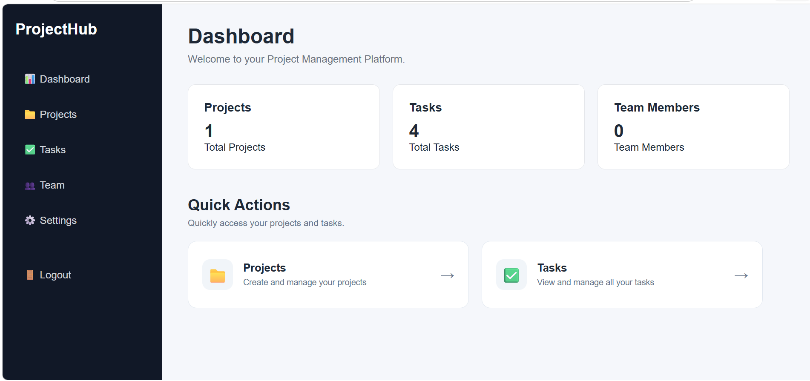
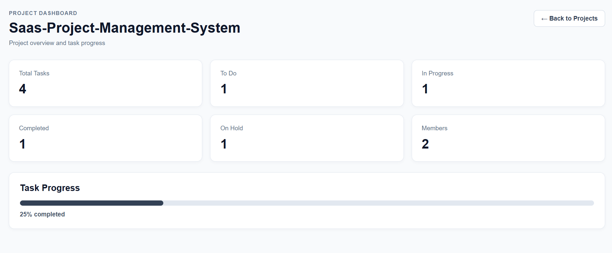
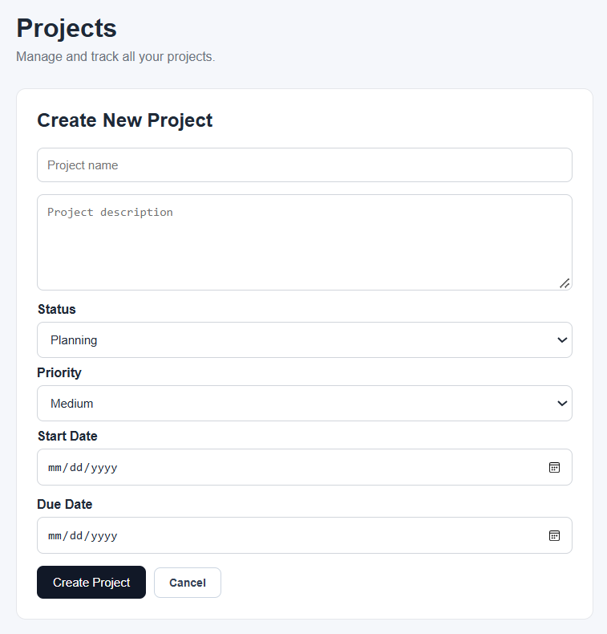
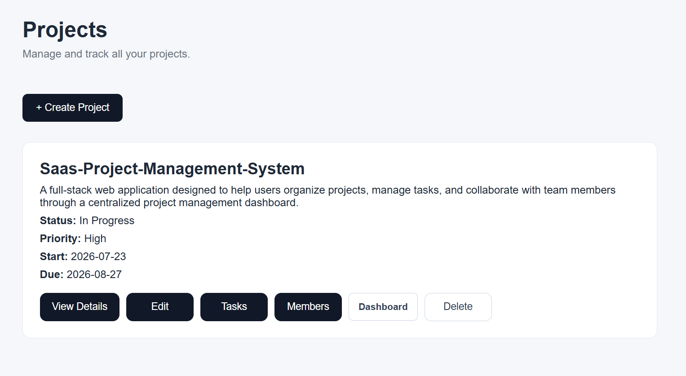
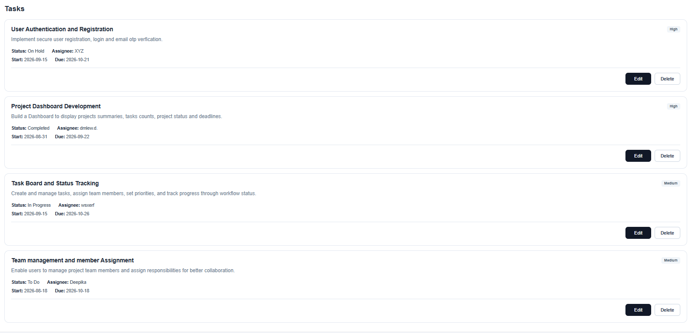
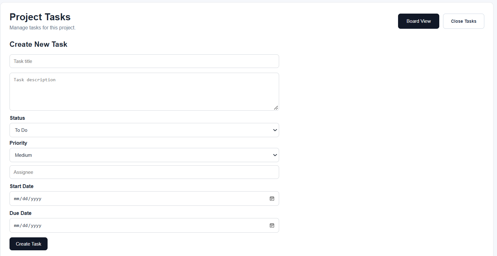
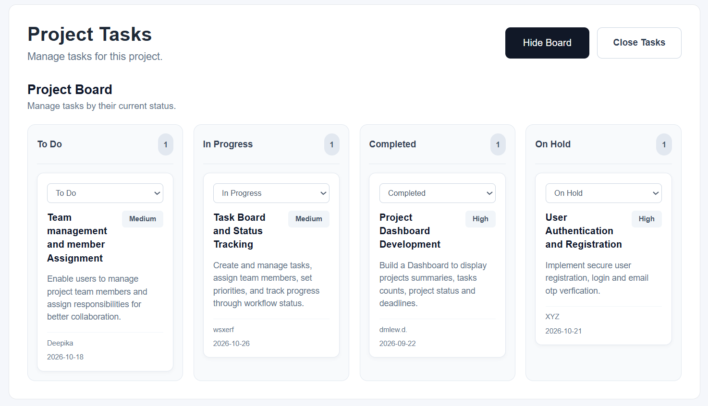
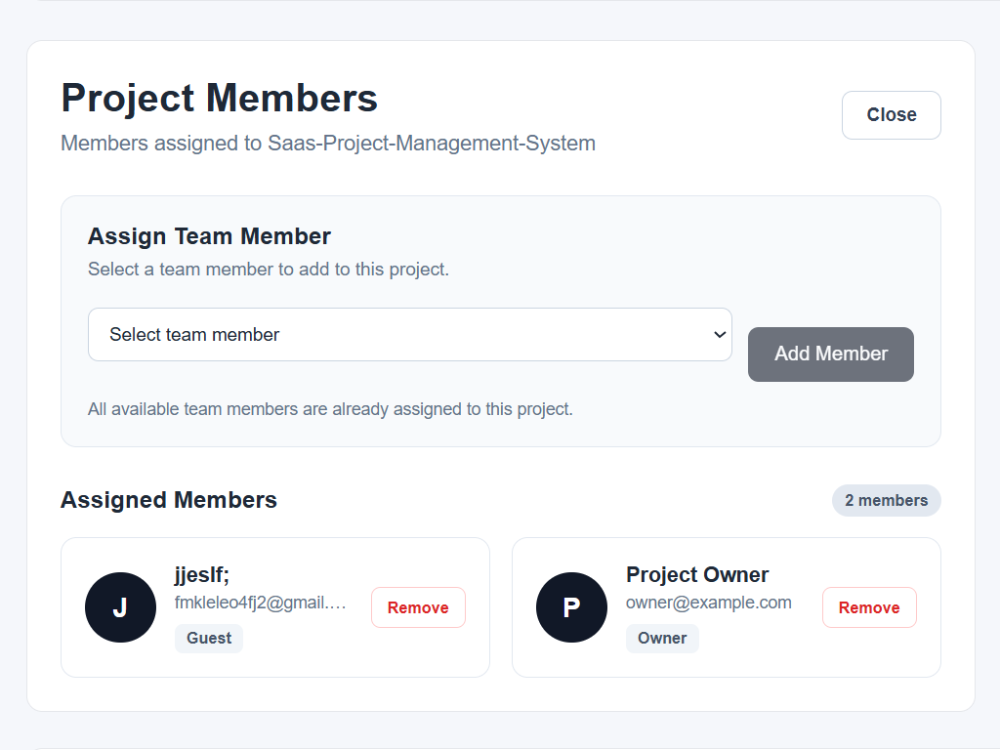

# SaaS Project Management Platform

A full-stack web application designed to help users organize projects, manage tasks, and collaborate with team members through a centralized project management dashboard.

## Overview

The **SaaS Project Management Platform** is a full-stack development capstone project inspired by modern project management tools. It follows a microservices-based architecture, separating the frontend, authentication service, and project service to support a modular application structure.

## Features

- **Dashboard:** Centralized view of project management information.
- **Project Management:** Create, view, update, and delete projects.
- **Task Management:** Create and manage tasks associated with projects.
- **Task Status Tracking:** Organize tasks by status, including To Do and other workflow states.
- **Team Management:** Manage project team members.
- **Authentication Service:** Separate backend service for user registration and authentication.
- **PostgreSQL Database:** Store application data in a relational database.
- **Responsive Interface:** Built with Next.js for a modern web experience.

*Note: Features listed reflect the current project implementation; additional SaaS capabilities may be developed in future versions.*

## Technology Stack

| Layer | Technologies |
|---|---|
| Frontend | Next.js, React, TypeScript |
| Backend | Node.js, Fastify |
| Database | PostgreSQL |
| Authentication | JWT, bcrypt |
| API Communication | REST APIs |
| Development Tools | Git, GitHub, Visual Studio Code |

## Project Structure

```text
saas-project-management-platform/
├── apps/
│   └── web/                  # Next.js frontend
├── database/
│   └── schema.sql            # Database schema
├── services/
│   ├── auth-service/         # Authentication service
│   └── project-service/      # Project and task APIs
├── infrastructure/          # Infrastructure-related files
├── packages/                 # Shared packages
├── docs/                     # Project documentation
├── tests/                    # Test-related files
├── .gitignore
└── README.md
```

## Getting Started

### Prerequisites

Install the following tools before running the application:

- Node.js and npm
- PostgreSQL
- Git
- Visual Studio Code (recommended)

### Installation

Clone the repository:

```bash
git clone https://github.com/Deepika-dev6/Saas-project-management-platform.git
cd Saas-project-management-platform
```

Install the frontend dependencies:

```bash
cd apps/web
npm install
```

Install the authentication service dependencies:

```bash
cd ../../services/auth-service
npm install
```

Install the project service dependencies:

```bash
cd ../project-service
npm install
```

### Environment Configuration

Create local `.env` files using the variable names required by each service. Configure your PostgreSQL connection and any required authentication or email settings.

**Security:** Never commit `.env` files, database passwords, JWT secrets, email credentials, or other private keys to GitHub.

### Running the Application

Start each service in a separate terminal.

**1. Frontend**

```bash
cd apps/web
npm run dev
```

**2. Authentication Service**

```bash
cd services/auth-service
npm run dev
```

**3. Project Service**

```bash
cd services/project-service
npm run dev
```

Check each service's configuration for its required environment variables and port settings.

## Architecture

The application is organized into three main components:

- **Frontend:** Provides the user interface and communicates with backend APIs.
- **Authentication Service:** Handles authentication-related operations.
- **Project Service:** Handles project and task management operations.

PostgreSQL serves as the relational database for application data.

## Future Improvements

Potential enhancements include:

- Multi-tenant organization management
- Role-based access control
- Real-time collaboration and notifications
- Advanced search and filtering
- File attachments
- Billing integration
- Automated testing and deployment

## Project Repository

GitHub: [SaaS Project Management Platform](https://github.com/Deepika-dev6/Saas-project-management-platform)

## Author

**Deepika**  
Software Developer | Technology Enthusiast


## 📸 Project Screenshots

### 1. Main Dashboard


### 2. Projects Dashboard


### 3. Create Projects


### 4. Projects Board


### 5. Tasks Board


### 6. Create Tasks


### 7. Board View


### 8. Members Board

